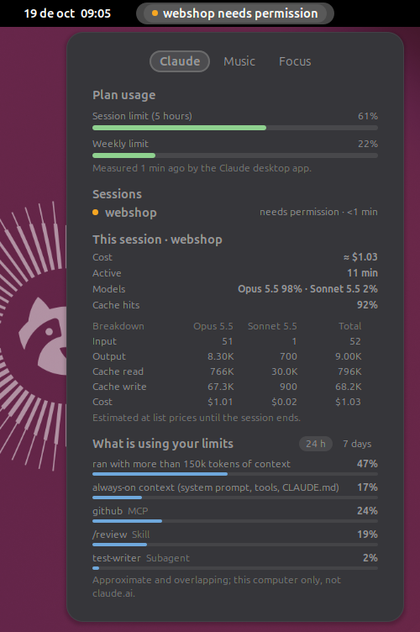
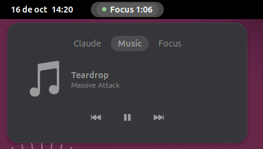
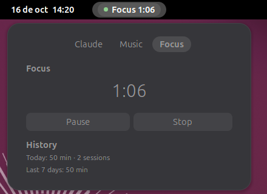

# Islet

A small dynamic island for the GNOME top bar: Claude Code usage and live agent alerts, what's
playing and a focus timer, right next to the clock. Local-first: no accounts, no telemetry.

<p align="center">
  
</p>

## What it shows

- **The capsule**, next to the clock: what needs you first (`islet needs permission`), then a
  running focus timer, then today's Claude Code usage (`Claude 1.21M · 33%`), then the song.
- **Live activities** that grow the capsule for a few seconds: an agent waiting for your
  permission or input, a finished reply, the 5-hour plan crossing 75 %, 90 % and 100 %, a focus session
  ending, a new song.
- **The expanded view** (click, or `Ctrl+Alt+Space`):
  - **Claude:** like the usage panel of the Claude desktop app. The 5-hour and weekly plan
    limits; the current sessions and what each is waiting for; this session's cost, active time,
    models and cache hits, with tokens and cost per model; and what is using your limits over
    24 hours or 7 days (long context, long or parallel sessions, and each MCP server, skill and
    subagent).
  - **Music:** any MPRIS player (Spotify, browsers, Rhythmbox…), with play/pause, previous, next.
  - **Focus:** 25 / 50 / 90 minute sessions with pause and stop, and today's and the week's totals.

<p align="center">
  
  
</p>

## Requirements

- Ubuntu 26.04 or another system with **GNOME Shell 50** (Wayland or X11)
- `gjs`, installed with GNOME on Ubuntu
- [Claude Code](https://code.claude.com) for the Claude features (terminal, desktop app or VS Code)

## Install

1. Download `islet-0.1.2.tar.gz` from the [latest release](https://github.com/jagosar/islet/releases/latest).
2. In a terminal:

   ```bash
   tar -xzf islet-0.1.2.tar.gz && cd islet-0.1.2 && ./install.sh
   ```

3. Log out and back in. Islet appears next to the clock.

The installer works for your user only and needs no `sudo`. It asks whether to **connect
Claude Code** (below); you can also do that later in Islet's preferences.

## Uninstall

From the same folder:

```bash
./uninstall.sh
```

It disconnects Claude Code (your `settings.json` goes back to exactly what it was), removes the
extension and deletes Islet's saved state. If you no longer have the folder, these two commands
do the same:

```bash
gjs -m ~/.local/share/gnome-shell/extensions/islet@jagosar.github.io/tools/claudeConnection.js disconnect
```

```bash
gnome-extensions uninstall islet@jagosar.github.io && rm -rf ~/.local/state/islet
```

## Connecting Claude Code

Token usage needs no setup: Islet reads it from Claude Code's transcripts. Connecting adds two
things to `~/.claude/settings.json`:

- **Hooks**, so the capsule knows when a session needs your permission, waits for you or
  finishes. They work in the terminal, the desktop app and VS Code.
- **A status line**, through which terminal sessions report your plan's 5-hour and weekly
  usage with their reset times. If you already have a status line, it keeps working unchanged
  through Islet.

Plan usage also comes, without any setup, from the Claude desktop app (which records it every
15 minutes or so while it runs) and from Claude Code's "You've hit your limit" messages. Islet
reads these local files only: it never uses your login or the network.

Islet keeps everything else in the file, saves a backup, shows the exact change before making it,
and Disconnect (or `./uninstall.sh`) removes exactly what it added. If Islet is ever removed
without disconnecting, its hooks do nothing and your old status line still runs.

## Privacy

Everything stays on this computer. Islet reads token counts and session events, never your
prompts or Claude's replies, and sends nothing anywhere.

## Performance

Measured on the development machine (Ubuntu 26.04, GNOME 50.1), daemon on GJS 1.88:

| Transcripts | First scan | Daemon memory (RSS) | Daemon CPU while idle |
|---|---|---|---|
| A real `~/.claude` (a few MB) | under 1 s | 38 MB | 0 ms per 30 s |
| Heavy use: 207 MB, 60,000 responses over 26 weeks | ~1 s | 45 MB | 0 ms per 30 s |

An empty GJS process takes about 31 MB. The extension adds no timers while nothing changes; the
focus countdown ticks once per second only while it runs.

## Development

```bash
npm install
npm run build          # TypeScript -> dist/
npm run test:all       # typecheck, strict lint, unit with coverage gate, GJS smoke, integration and package tests
npm run e2e            # end to end in a nested GNOME Shell (needs mutter-dev-bin)
npm run nested         # run dist/ in an isolated nested GNOME Shell
npm run nested:zip     # pack, install the zip and run it in the nested Shell
npm run release        # build islet-VERSION.tar.gz with the installer
```

How it is tested, and what is deliberately not automated: [docs/TESTING.md](docs/TESTING.md).

The nested Shell never touches your real session: it gets its own configuration, data, cache
and D-Bus session under `$XDG_RUNTIME_DIR/islet-devkit/`. The design is in
[docs/ARCHITECTURE.md](docs/ARCHITECTURE.md).

## Credits and license

Inspired by [Developer Island](https://github.com/maximilian467/Developer-Island) for Windows.
Islet is an independent implementation for GNOME Shell; it shares ideas, not code.

Islet is free software under the [GNU General Public License v2.0 or later](LICENSE).
